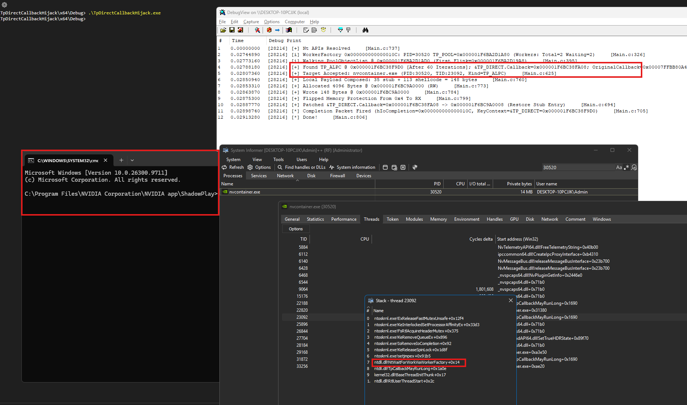
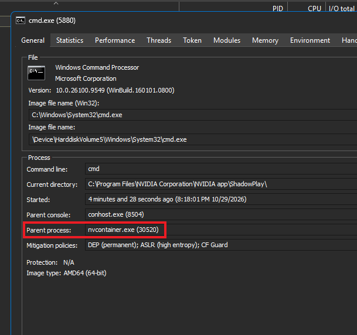

# TpDirectCallbackHijack

Remote process injection PoC that triggers the shellcode by overwriting 8 bytes inside an existing thread pool object (the embedded `TP_DIRECT.Callback` field of a `TP_IO`, `TP_ALPC`, or `TP_JOB`) and dispatches the shellcode through the target's own pool worker.

### Quick Links

[Maldev Academy Home](https://maldevacademy.com?ref=gh)

[Maldev Database](https://search.maldevacademy.com?ref=gh)
  
[Malware Development Course Syllabus](https://maldevacademy.com/maldev-course/syllabus?ref=gh)

[Offensive Phishing Operations Course Syllabus](https://maldevacademy.com/phishing-course/syllabus?ref=gh)

[Ransomware Internals, Simulation and Detection Course Syllabus](https://maldevacademy.com/ransomware-course/syllabus?ref=gh)

<br>

## Overview

A Windows thread pool worker in the target process spends most of its life parked inside [`ntdll!NtWaitForWorkViaWorkerFactory`](https://ntdoc.m417z.com/ntwaitforworkviaworkerfactory), blocked on the pool's internal I/O completion port (an [IoCompletion](https://learn.microsoft.com/en-us/windows/win32/fileio/i-o-completion-ports) handle). When another thread posts a completion packet to that port via [NtSetIoCompletion](https://ntdoc.m417z.com/ntsetiocompletion), the kernel wakes the worker and hands it the packet's [KeyContext](https://ntdoc.m417z.com/ntsetiocompletion) value. For pool-dispatched work, `KeyContext` points at a `_TP_DIRECT` descriptor. The worker reads the `_TP_DIRECT.Callback` field out of that descriptor and calls it, passing the descriptor itself as the first argument.

That `Callback` field is a function pointer sitting in writable memory in the process. Overwriting it with a pointer to attacker-controlled code and then posting a single completion packet with `KeyContext = &TP_DIRECT` makes the worker dispatch to the attacker's code, on the host's own thread, with a call stack that looks indistinguishable from a legitimate pool callback.

This repo covers target discovery, the pool walk, payload delivery, the Callback hijack, and a restore stub that puts the original function pointer back so the host's thread pool keeps working normally after the payload returns.


### What is `TP_DIRECT` ?

`_TP_DIRECT` is an undocumented ntdll internal structure used by the Windows thread pool to describe one unit of callback dispatch. It is not exported and has no public header. Its layout was reverse-engineered and fetched from WinDbg's `dt ntdll!_TP_DIRECT`, which on Windows 11 24H2 (ntdll 10.0.26100.9711) looks like:

```
0:004> dt ntdll!_TP_DIRECT
   +0x000 Task                        : _TP_TASK
   +0x020 Lock                        : Uint8B
   +0x028 IoCompletionInformationList : _LIST_ENTRY
   +0x038 Callback                    : Ptr64 Void
   +0x040 NumaNode                    : Uint4B
   +0x044 IdealProcessor              : UChar
```

What matters here is `Callback` at `+0x38`, which represents the raw function pointer the pool dispatcher calls. The full structure definition used by this project lives in [InternalStructures.h](https://github.com/Maldev-Academy/TpDirectCallbackHijack/blob/main/TpDirectCallbackHijack/InternalStructures.h#L277-L285), derived from WinDbg output and verified across the Windows versions listed in [Supported Windows versions](#supported-windows-versions).

<br>


## Technique


### Pool Worker Dispatch

For every `TP_IO` / `TP_ALPC` / `TP_JOB`, ntdll embeds a `_TP_DIRECT` descriptor inside the outer struct. When a worker dequeues a packet from the pool's completion port, the dispatch chain:

1. Reads `KeyContext` from the packet. This is a pointer to the embedded `_TP_DIRECT`.
2. Reads `TP_DIRECT.Callback` (field at `+0x38` inside the `_TP_DIRECT`).
3. Calls that function pointer with `RCX = &TP_DIRECT`.


The hijack:

1. Patch `TP_DIRECT.Callback` to point at the restore stub.
2. Fire a completion packet on an [`IoCompletion`](https://learn.microsoft.com/en-us/windows/win32/fileio/i-o-completion-ports) handle duplicated out of the target, with `KeyContext = &TP_DIRECT`.


### Supported pool objects

| Kind      | `_TP_DIRECT` offset in outer | `Callback` offset in outer |
|-----------|------------------------------|----------------------------|
| `TP_IO`   | `+0x0C8`                     | `+0x100`                   |
| `TP_ALPC` | `+0x000`                     | `+0x038`                   |
| `TP_JOB`  | `+0x000`                     | `+0x038`                   |

The outer struct definitions for all three live in [InternalStructures.h](https://github.com/Maldev-Academy/TpDirectCallbackHijack/blob/main/TpDirectCallbackHijack/InternalStructures.h#L443-L493). They are identified at walk time by the per-kind `TppXpCleanupGroupMemberVFuncs` pointer stored at `TPP_CLEANUP_GROUP_MEMBER.VFuncs`. The hardcoded RVAs for those tables live in [Common.h](https://github.com/Maldev-Academy/TpDirectCallbackHijack/blob/main/TpDirectCallbackHijack/Common.h#L56-L58) and are regenerated per ntdll build using the companion [`NtdllRvaCheck`](#ntdllrvacheck) utility.

### Restore stub

The restore stub reads only from fixed PE relative data slots inside its own payload. It never relies on registers at entry, which makes it work identically regardless of which object kind dispatched into it.

```
[+0x00..+0x07] Data slot: original TP_DIRECT.Callback value (patched by EmitRestoreStub)
[+0x08]        push rax
[+0x09]        push rcx
[+0x0A]        lea  rax, [rip - 0x11]        ; rax = &data_slot
[+0x11]        mov  rax, [rax]                ; rax = original Callback value
[+0x14]        mov  rcx, imm64                ; rcx = &TP_DIRECT.Callback (patched by EmitRestoreStub)
[+0x1E]        mov  [rcx], rax                ; *(&TP_DIRECT.Callback) = original
[+0x21]        pop  rcx
[+0x22]        pop  rax
[+0x23]        (payload falls through here)
```

The stub restores `TP_DIRECT.Callback` to its original value, then falls through into the user payload. The payload's final `ret` lands back in `ntdll!TppWorkerThread`'s dispatch loop, and the thread re-enters its wait.

Both runtime-dependent slots (the original callback value at `+0x00`, and the `&TP_DIRECT.Callback` imm64 at `+0x16`) are patched in by [`EmitRestoreStub`](https://github.com/Maldev-Academy/TpDirectCallbackHijack/blob/main/TpDirectCallbackHijack/Main.c#L186) before the buffer is written into the target.

<br>


## Target discovery

[`FindTpInjectTargetProcess`](https://github.com/Maldev-Academy/TpDirectCallbackHijack/blob/main/TpDirectCallbackHijack/Main.c#L477) walks every process in the system via [`NtQuerySystemInformation(SystemProcessInformation)`](https://learn.microsoft.com/en-us/windows/win32/api/winternl/nf-winternl-ntquerysysteminformation) and accepts the first candidate that satisfies all of the following gates in order:

| Gate | Requirement                                                                                                                                                             | Why                                                                                            |
|------|-------------------------------------------------------------------------------------------------------------------------------------------------------------------------|------------------------------------------------------------------------------------------------|
| (a)  | 64 bit (not WoW64), via [`NtQueryInformationProcess(ProcessWow64Information)`](https://ntdoc.m417z.com/ntqueryinformationprocess) | Payload and offsets are x64 only.                                                              |
| (b)  | Has at least one thread in `ThreadState=Waiting` / `WaitReason=WrQueue`                                                                                                 | Cheap proxy for "this process has a worker parked on an IOCP that can dispatch our packet."    |
| (c)  | Openable with `PROCESS_VM_OPERATION \| PROCESS_VM_READ \| PROCESS_VM_WRITE \| PROCESS_QUERY_INFORMATION \| PROCESS_DUP_HANDLE` via [`NtOpenProcess`](https://ntdoc.m417z.com/ntopenprocess) | Scanner needs all five.                                                                        |
| (d)  | Exposes a duplicatable `TpWorkerFactory` handle (via `SystemExtendedHandleInformation` and [`NtDuplicateObject`](https://ntdoc.m417z.com/ntduplicateobject))                                | Required to resolve the target's `_TP_POOL` base through [`NtQueryInformationWorkerFactory`](https://ntdoc.m417z.com/ntqueryinformationworkerfactory). |
| (e)  | `TP_POOL.PoolObjectList` contains at least one `TP_IO` / `TP_ALPC` / `TP_JOB`                                                                                           | We need at least one structure to hijack.                                                       |
| (f)  | Exposes a duplicatable `IoCompletion` handle                                              | Needed to fire the dispatch packet.                                                            |


## NtdllRvaCheck

Standalone probe utility. Creates throwaway local `TP_IO`, `TP_ALPC`, and `TP_JOB` objects inside itself via [`CreateThreadpoolIo`](https://learn.microsoft.com/en-us/windows/win32/api/threadpoolapiset/nf-threadpoolapiset-createthreadpoolio) + [`CreateNamedPipeW`](https://learn.microsoft.com/en-us/windows/win32/api/namedpipeapi/nf-namedpipeapi-createnamedpipew), [`TpAllocAlpcCompletion`](https://ntdoc.m417z.com/tpallocalpccompletion) + [`NtAlpcCreatePort`](https://ntdoc.m417z.com/ntalpccreateport), and `TpAllocJobNotification` + [`CreateJobObjectW`](https://learn.microsoft.com/en-us/windows/win32/api/jobapi2/nf-jobapi2-createjobobjectw) respectively; reads the field pointers out of each live object; subtracts `ntdll`'s module base; and prints the full RVA set ready to paste into `Common.h`.

### Why it is a separate binary

The pool walker in [Main.c](https://github.com/Maldev-Academy/TpDirectCallbackHijack/blob/main/TpDirectCallbackHijack/Main.c#L356) needs to identify what kind of pool object each `_TPP_CLEANUP_GROUP_MEMBER` sits inside. It does this by matching `CleanupGroupMember.VFuncs` against three per-kind tables inside ntdll:

* `ntdll!TppIopCleanupGroupMemberVFuncs`
* `ntdll!TppAlpcpCleanupGroupMemberVFuncs`
* `ntdll!TppJobpCleanupGroupMemberVFuncs`

None of these are exported, so they cannot be resolved by name. They are computed as `(ntdll_base + RVA)` at startup. The RVAs change per ntdll build, so they are regenerated by running this probe against the ntdll version shipped on the target OS.

The RVA derivation could be merged into the main injector. Doing so would drag `CreateNamedPipeW`, `CreateThreadpoolIo`, `NtAlpcCreatePort`, `TpAllocAlpcCompletion`, `TpAllocJobNotification`, and a named pipe artifact into the injector's IAT. Keeping the probe as a separate executable keeps the IAT minimal and runtime behavior free of any pool object creation of its own.

### Sample output (Windows 11 24H2, build 10.0.26100.9711)

```
#define TPP_IOP_CLEANUP_GROUP_MEMBER_VFUNCS_RVA     0x174BE8
#define TPP_IOP_EXECUTE_CALLBACK_RVA                0x088F50

#define TPP_ALPCP_CLEANUP_GROUP_MEMBER_VFUNCS_RVA   0x174DD0
#define TPP_ALPCP_EXECUTE_CALLBACK_RVA              0x024150

#define TPP_JOBP_CLEANUP_GROUP_MEMBER_VFUNCS_RVA    0x174C08
#define TPP_JOBP_EXECUTE_CALLBACK_RVA               0x0BF5F0
```

### Sample output (Windows 11 24H2, build 10.0.26300.9818)

```
#define TPP_IOP_CLEANUP_GROUP_MEMBER_VFUNCS_RVA     0x178BE8
#define TPP_IOP_EXECUTE_CALLBACK_RVA                0x077790

#define TPP_ALPCP_CLEANUP_GROUP_MEMBER_VFUNCS_RVA   0x178DD0
#define TPP_ALPCP_EXECUTE_CALLBACK_RVA              0x024150

#define TPP_JOBP_CLEANUP_GROUP_MEMBER_VFUNCS_RVA    0x178C08
#define TPP_JOBP_EXECUTE_CALLBACK_RVA               0x0C1F10
```

This project currently uses only the three `*_CLEANUP_GROUP_MEMBER_VFUNCS_RVA` values. The `*_EXECUTE_CALLBACK_RVA` lines are the per-kind dispatch entries (`ntdll!TppIopExecuteCallback` etc.) and are printed alongside for completeness. 


### WinDbg cross-check

The same RVAs can be derived manually via WinDbg:

```
0:004> ? ntdll!TppIopCleanupGroupMemberVFuncs    - ntdll
Evaluate expression: 1526760 = 00000000`00174be8
0:004> ? ntdll!TppAlpcpCleanupGroupMemberVFuncs  - ntdll
Evaluate expression: 1527248 = 00000000`00174dd0
0:004> ? ntdll!TppJobpCleanupGroupMemberVFuncs   - ntdll
Evaluate expression: 1526792 = 00000000`00174c08
```

## Supported Windows versions

Internal struct offsets in [InternalStructures.h](https://github.com/Maldev-Academy/TpDirectCallbackHijack/blob/main/TpDirectCallbackHijack/InternalStructures.h) have been verified against:

* Windows 10 1607 / Server 2016 LTSC   (ntdll 10.0.14393.x)
* Windows 10 1809 / Server 2019 LTSC   (ntdll 10.0.17763.x)
* Windows 10 21H2 / 22H2               (ntdll 10.0.19041.x)
* Windows 11 22H2 / 23H2               (ntdll 10.0.22621.x)
* Windows 11 24H2 / Server 2025        (ntdll 10.0.26100.x)
* Windows 11 26H1 (Insider Preview)    (ntdll 10.0.28000.x)

The `TppXp*VFuncs` RVAs in `Common.h` are specific to 10.0.26100.9711 as shipped. For any other build, regenerate with `NtdllRvaCheck`.


### Sample run



<br>



<br>


## Known limitations

* **Hardcoded ntdll RVAs.** `Common.h` ships with values for Windows 11 24H2 build 10.0.26100.9711. Any other ntdll build requires regenerating via `NtdllRvaCheck` on that build. The internal struct offsets in `InternalStructures.h` have been verified across all Windows versions listed above and have not shifted; the `TppXp*VFuncs` RVAs do shift between builds.

* **Non-TPP `WrQueue` threads.** `WaitReason=WrQueue` matches any thread blocked on a `KQUEUE`, which includes .NET `PortableThreadPool.IOCompletionPoller` threads, libuv's IOCP backend, custom thread pools, server frameworks, and anything else sitting in [`GetQueuedCompletionStatus`](https://learn.microsoft.com/en-us/windows/win32/api/ioapiset/nf-ioapiset-getqueuedcompletionstatus) / [`GetQueuedCompletionStatusEx`](https://learn.microsoft.com/en-us/windows/win32/fileio/getqueuedcompletionstatusex-func). The scanner uses `WrQueue` only as a cheap proxy for "this process touches IOCP"; the real filtering happens through the `TpWorkerFactory` to `TP_POOL` to pool object chain, which rejects anything that is not a genuine Win32 thread pool.

## Acknowledgements

Builds on [SafeBreach Labs' Pool Party research](https://github.com/SafeBreach-Labs/PoolParty) (Alon Leviev, Black Hat EU 2023, [blog post](https://www.safebreach.com/blog/process-injection-using-windows-thread-pools/)). This project borrows from several of the variants of the aforementioned repo:

* Object kinds (`TP_IO` / `TP_ALPC` / `TP_JOB`) from variants 4, 5, 6.
* The `_TP_DIRECT.Callback` dispatch primitive from variant 7.
* [`NtSetIoCompletion`](https://ntdoc.m417z.com/ntsetiocompletion) as the trigger from variant 4.
